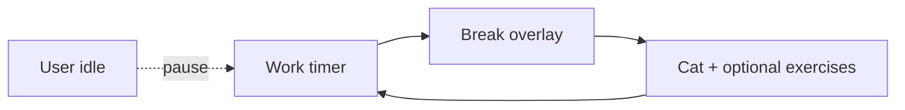

# Cat Break

### **Eye breaks for your desktop - with a cat.**

[](https://github.com/anatoly-kulishov/CatBreak/releases)
[](#-platform-support)
[](https://www.electronjs.org/)
[](LICENSE)
[](https://github.com/anatoly-kulishov/CatBreak/pulls)

[Quick start](#-quick-start) · [Features](#-features) · [Build](#-build) · [Docs](docs/en/) · [Releases](https://github.com/anatoly-kulishov/CatBreak/releases)

---

**Cat Break** is a cross-platform **eye strain / break reminder** for developers and desk workers: system tray timer, fullscreen overlay on every monitor, optional exercises, and a cat on the break screen.

**Keywords:** eye break reminder, 20-20-20, eye strain, pomodoro-like break timer, macOS menu bar, Windows tray, Linux AppIndicator, Electron desktop app, healthy screen time.

---

## Why Cat Break?

| Without | With Cat Break |
| :--- | :--- |
| “I’ll rest later” → dry eyes | Timed work / break cycles (default 55 / 5) |
| Break on one screen only | Overlay on **every** display |
| Timer apps that nag forever | Idle pause, postpone, optional strict mode |
| English-only UI | **EN + RU** |



---

## Features

| Feature | Description |
| :------ | :---------- |
| **Work / break timer** | Configurable intervals (default 55 / 5 min) |
| **System tray** | macOS menu bar · Windows tray · Linux AppIndicator |
| **Fullscreen overlay** | One window per monitor |
| **Cat animation** | Break screen companion |
| **Idle pause** | Stops the work clock while you’re away |
| **Eye exercises** | Optional guided prompts |
| **Strict mode** | Hide skip when you need discipline |
| **Demo** | 30-second break preview |
| **i18n** | English & Russian (Settings → Language) |
| **Postpone** | +5 / +10 minutes |
| **Launch at login** | macOS / Windows |

---

## Platform support

| Platform | Status | Build | Docs |
| :------- | :----- | :---- | :--- |
| **macOS** 12+ (Apple Silicon / Intel) | Primary | `npm run dist:mac` | [en/MACOS_INSTALL.md](docs/en/MACOS_INSTALL.md) · [ru](docs/ru/) |
| **Windows** 10/11 x64, arm64 | Supported | `npm run dist:win` | [en/WINDOWS_INSTALL.md](docs/en/WINDOWS_INSTALL.md) |
| **Linux** x64 (AppImage, deb) | Supported* | `npm run dist:linux` | [en/LINUX_INSTALL.md](docs/en/LINUX_INSTALL.md) |

\* On **Wayland**, always-on-top overlays may be limited; **X11** is more reliable.

---

## Quick start

```bash
git clone https://github.com/anatoly-kulishov/CatBreak.git
cd CatBreak
npm install
npm start
```

Tray icon → right-click → **Settings** or **Demo (30 sec)**.

Prefer binaries? Grab a build from [Releases](https://github.com/anatoly-kulishov/CatBreak/releases).

---

## Build

```bash
npm install
npm run prepare    # generates build/icon.ico for Windows
npm run dist:mac   # DMG + ZIP (on macOS)
npm run dist:win   # NSIS + portable (best on Windows; Wine on Mac for NSIS)
npm run dist:linux # AppImage + deb (best on Linux)
npm run dist:all   # all targets (slow; cross-compile limits apply)
```

Artifacts land in `dist/`.

| Command | Run on | Output |
| :------ | :----- | :----- |
| `dist:mac` | macOS | `.dmg`, `.zip` |
| `dist:win` | Windows (or macOS + Wine) | `Setup.exe`, portable `.exe` |
| `dist:linux` | Linux | `.AppImage`, `.deb` |

> **macOS:** do not run `codesign --deep` on the `.app` - it breaks Electron Framework signatures and the app will crash on launch.

### GitHub Releases

Attach platform artifacts per release:

- macOS: `*.dmg`, `*-mac.zip`
- Windows: `*Setup*.exe`, portable `*.exe`
- Linux: `*.AppImage`, `*.deb`

Unsigned builds: users may need **Right-click → Open** (macOS) or SmartScreen confirmation (Windows). See [docs/en/](docs/en/) or [docs/ru/](docs/ru/).

---

## Usage

1. Launch - a tray icon appears.
2. Wait for a break, or **Start break now** / **Demo (30 sec)**.
3. When the timer ends, overlays close automatically.
4. **Settings** - intervals, idle pause, exercises, strict mode, language.

On **Windows/Linux**, countdown is in the tray **tooltip**. On **macOS**, it also shows next to the menu bar icon.

---

## Project layout

```text
CatBreak/
├── main.js
├── preload-*.js
├── lib/           # timer, break windows, updates, platform
├── locales/
├── src/
├── assets/
├── build/
├── landing/       # GitHub Pages
├── docs/
└── scripts/
```

---

## FAQ

**Is this a Pomodoro app?**  
Work/break cycles are similar, but the product focus is **eye rest** (fullscreen break + optional exercises), not task tracking.

**Does it change system settings?**  
No. Tray app + overlay windows only.

**Wayland issues?**  
Prefer X11 for reliable always-on-top overlays.

---

## License

[MIT](LICENSE) · [Icon credits](build/ICON_CREDITS.txt)

---

**If Cat Break helps your eyes - ⭐ the [repo](https://github.com/anatoly-kulishov/CatBreak).**
